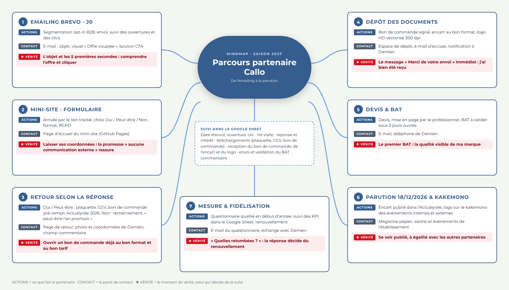

# 1. Ce que vous avez dans le dossier

| Dossier ou fichier | Rôle |
|---|---|
| `index.html` | Page d'accueil : offre et formulaire de réponse (Oui / Peut-être / Non) |
| `merci.html` | Page de retour Oui / Peut-être : plaquette, CGV, bon de commande pré-rempli, Actualycée 2026, contact Damien, commentaire |
| `merci-non.html` | Page de retour Non : remerciement, « peut-être l'an prochain » |
| `depot.html` | Espace de dépôt : bon de commande signé, encart, logo, puis message « Merci de votre envoi » |
| `css/`, `js/`, `assets/` | Mise en forme, comportement, images et police Montserrat (hébergée sur le site) |
| `js/config.js` | **Le seul fichier à modifier** : adresse du script Google et code de sécurité |
| `docs/` | Plaquette V2.6, CGV V2.3, annexes 2 à 4, Actualycée 2026, 6 bons de commande (PDF et .docx), mindmap |
| `apps-script/Code.gs` | Le code à coller dans Google Sheet (suivi des KPI, dépôt dans Drive, alertes e-mail) |
| `email/brevo-gabarit.html` | Le gabarit de l'emailing à coller dans Brevo |

Parcours complet, avec points de contact et moments de vérité : `docs/Mindmap_Parcours_Partenaire_Callo_2027.png`.



# 2. Étape 1 : mettre le mini-site en ligne (GitHub Pages)

**À savoir sur l'adresse.** Une adresse GitHub Pages n'a pas de `www`. Le brief indique `https://www.regie-publicitaire-callo.github.io`, qui ne fonctionnera pas. L'adresse correcte est `https://regie-publicitaire-callo.github.io`, à condition que le compte GitHub s'appelle exactement `regie-publicitaire-callo`.

1. Créez un compte GitHub nommé `regie-publicitaire-callo` (ou une organisation de ce nom) sur github.com.
2. Dans ce compte, créez un dépôt **public** nommé exactement `regie-publicitaire-callo.github.io`.
3. Cliquez sur **Add file > Upload files** et glissez **tout le contenu** du dossier (pas le dossier lui-même : `index.html` doit se trouver à la racine). Validez avec **Commit changes**.
4. Allez dans **Settings > Pages**. Sous « Build and deployment », choisissez **Deploy from a branch**, branche **main**, dossier **/ (root)**, puis **Save**.
5. Attendez 1 à 2 minutes, puis ouvrez `https://regie-publicitaire-callo.github.io`. La page d'accueil doit s'afficher.

*Variante avec votre compte actuel (DamsMindset)* : créez un dépôt public `regie-publicitaire-callo` et activez Pages de la même façon. L'adresse sera `https://damsmindset.github.io/regie-publicitaire-callo/`. Dans ce cas, remplacez cette adresse dans `email/brevo-gabarit.html` (étape 4).

*Le fichier `docs/Actualycee_2026.pdf` pèse 12 Mo.* Il passe sur GitHub, mais s'ouvre lentement sur mobile. Vous pouvez le remplacer par une version allégée sous le même nom.

# 3. Étape 2 : créer le Google Sheet et installer le script

1. Dans Google Drive, créez une feuille Google nommée **Suivi régie Callo 2027**.
2. Dans la feuille : **Extensions > Apps Script**. Supprimez le code présent et collez **tout** le contenu de `apps-script/Code.gs`.
3. En haut du code, dans `CONFIG`, modifiez :
   - `TOKEN` : un code de votre choix (ex. `callo2027-k8Pq2`). Notez-le : il doit être identique dans `js/config.js`.
   - `NOTIFY_EMAIL` : l'adresse qui reçoit une alerte à chaque réponse, dépôt ou commentaire.
4. Dans la barre d'outils, choisissez la fonction **setup** et cliquez **Exécuter**. Google demande des autorisations (feuille, Drive, envoi d'e-mails) : acceptez avec le compte qui hébergera les données. Si l'écran « Application non vérifiée » apparaît : **Paramètres avancés > Accéder à… (non sécurisé)**, c'est votre propre script.
5. Les onglets **Suivi**, **Journal** et **Tableau de bord** sont créés.
6. **Déployer > Nouveau déploiement > Type : Application Web** :
   - Description : `Régie Callo v1`
   - Exécuter en tant que : **Moi**
   - Qui a accès : **Tout le monde**
   Cliquez **Déployer** et copiez l'**URL de l'application Web** (elle se termine par `/exec`).
7. Collez cette URL dans un navigateur : vous devez lire `{"ok":true,"service":"Régie Callo 2027"}`.

**Après toute modification du script**, refaites **Déployer > Gérer les déploiements > Modifier (crayon) > Version : Nouvelle version**, sinon l'ancienne version continue de tourner.

# 4. Étape 3 : relier le site au Google Sheet

1. Sur GitHub, ouvrez `js/config.js` et cliquez sur le crayon.
2. Renseignez :
   ```
   APPS_SCRIPT_URL: "https://script.google.com/macros/s/XXXXXXXX/exec",
   TOKEN: "le même code que dans Code.gs",
   ```
3. **Commit changes**, attendez 1 minute, rechargez le site.
4. **Test de bout en bout** (à faire avec une adresse de test, par exemple la vôtre) :

| Action de test | Résultat attendu dans le Sheet |
|---|---|
| Ouvrir `https://…/?e=votre@mail.fr&c=test` | Une ligne apparaît, « Date 1re visite site » remplie |
| Remplir et envoyer le formulaire (Oui + un format) | Colonnes entreprise, nom, intérêt, formats, RGPD remplies ; vous recevez une alerte e-mail ; arrivée sur `merci.html` |
| Cliquer « Télécharger la plaquette », « le bon de commande » | « Date DL plaquette », « Date DL bon de commande » et « Variante » remplies |
| Aller sur « Déposer mon bon de commande… » et envoyer 3 fichiers | Dates de réception remplies, lien « Dossier Drive », e-mail d'accusé reçu, message « Merci de votre envoi » à l'écran |
| Écrire un commentaire | Colonne « Commentaire partenaire » remplie |

Tant que `APPS_SCRIPT_URL` est vide, le site fonctionne en **mode démonstration** : le parcours s'affiche mais rien n'est enregistré.

# 5. Étape 4 : installer l'emailing dans Brevo

1. Dans `email/brevo-gabarit.html`, faites **Rechercher / Remplacer** : `https://regie-publicitaire-callo.github.io` par l'adresse réelle du site (étape 1).
2. Brevo : **Campagnes > Modèles > Créer un modèle > Éditeur HTML (coller votre code)**. Collez le fichier et enregistrez.
3. Objet conseillé : *Offre inédite 2027 : votre encart + votre logo sur le kakemono Callo, dès 400 €*. Le pré-header est déjà dans le gabarit.
4. Les variables `{{ contact.FIRSTNAME }}`, `{{ contact.EMAIL }}`, `{{ mirror }}` et `{{ unsubscribe }}` sont reconnues par Brevo. Vérifiez que vos contacts ont l'attribut **PRÉNOM (FIRSTNAME)**.
5. Envoyez-vous un **e-mail de test**, ouvrez-le sur mobile et sur ordinateur, cliquez sur le bouton : le site doit s'ouvrir avec `?e=votre@mail.fr&c=email1` dans l'adresse.
6. **Suivi des envois, ouvertures et clics dans le Sheet** : dans Brevo, **Paramètres > Webhooks** (webhooks marketing), créez un webhook :
   - URL : `URL_DU_SCRIPT/exec?k=VOTRE_TOKEN`
   - Événements : envoyé / délivré, ouvert, clic, désinscription, rebond

   Les colonnes « Date envoi », « Date ouverture » et « Date clic » du Sheet se remplissent alors seules. Si votre formule Brevo ne propose pas de webhook, ces trois indicateurs restent disponibles dans les statistiques de la campagne Brevo, et le site continue d'enregistrer les visites des contacts venus par le bouton.
7. Pour les relances, changez `c=email1` en `c=relance1` puis `c=dernier-mail` dans les deux liens : le Sheet garde la trace de la campagne d'origine.

**Avant le premier envoi** : vérifiez que la liste est bien en opt-in B2B (consentement ou intérêt légitime documenté), que le lien de désinscription fonctionne et que la mention RGPD du pied de page correspond à votre registre de traitements. Faites relire ce point par la personne en charge du RGPD de l'établissement.

# 6. Suivi des KPI : ce que contient le Google Sheet

| Onglet | Contenu |
|---|---|
| **Suivi** | Une ligne par contact (clé : e-mail). Colonnes automatiques : envoi, ouverture, clic, visite, réponse, intérêt, formats, téléchargements, réception du bon de commande, de l'encart et du logo, dossier Drive, commentaire, statut. **Colonnes à saisir à la main** (suffixe « manuel ») : envoi du devis, envoi du BAT, validation du BAT, montant net |
| **Journal** | Chaque événement horodaté (visite, réponse, téléchargement, dépôt, commentaire, erreur) |
| **Tableau de bord** | Compteurs et pourcentages : envoyés, ouverts, clics, réponses (Oui / Peut-être / Non), bons de commande téléchargés et reçus, encarts, logos, BAT envoyés et validés, chiffre d'affaires saisi |

**Statut automatique** de chaque contact : Envoyé, A ouvert, A cliqué, A visité le site, Oui à convertir, Peut-être à relancer, Non (relance N+1), Bon de commande téléchargé, Bon de commande reçu, Documents reçus (BAT à produire), BAT envoyé, BAT validé. Il se met à jour quand vous saisissez une date « manuel ».

Les fichiers déposés arrivent dans le dossier Drive **Régie Callo 2027 - Dépôts partenaires**, un sous-dossier par entreprise, avec des noms du type `encart_Entreprise_20261120-1430_fichier.pdf`.

# 7. Les documents à télécharger

| Fichier | Contenu |
|---|---|
| `Plaquette_Regie_Publicitaire_Callo_2027_V2.6.pdf` | Plaquette unique. Prix 320 / 400 / 650 €, packs 400 / 480 / 700 €, réservation jusqu'au 01/12/2026 |
| `CGV_Regie_Publicitaire_Callo_2027_V2.3.pdf` | CGV unique, **inchangée** (V2.3 du 02/11/2026) |
| `bons-de-commande/BC_Callo_2027_*.pdf et .docx` | 6 variantes pré-remplies : Encart 1/6, 1/4, 1/2 et Pack Partenaire 1/6, 1/4, 1/2. Chaque bon reprend le format, le prix net, la remise volume, le paiement, les conditions d'annulation, la date limite de réservation et le BAT sous 3 jours ouvrés |
| `Annexes_CGV_2_a_4_Callo_2027_V2.3.pdf` | Fiche technique, formulaire de rétractation, grille tarifaire (320 € et packs mis à jour) |
| `Actualycee_2026.pdf` | Numéro 2026 à feuilleter |

Pour changer un document, remplacez le fichier **sous le même nom** dans `docs/` : les liens du site n'ont pas à être modifiés.

# 8. Délai de réalisation

Les durées ci-dessous sont des **estimations** de charge pour Damien, à partir de ce dossier livré le jeudi 12/11/2026. La date limite de réservation est le 01/12/2026 et la parution le 18/12/2026.

| Quand | Tâche | Charge estimée |
|---|---|---|
| Jeu 12/11 | Livrables prêts (site, script, gabarit, documents, mindmap) | fait |
| Ven 13/11 | Relecture et validation : prix, CGV, date du 01/12, adresse du site, photo, titre de l'email. Validation de la direction de l'établissement (compatibilité des encarts avec le projet éducatif) | 1 à 2 h |
| Lun 16/11, matin | Compte GitHub et mise en ligne du site (étape 1) ; Google Sheet et script (étape 2) ; liaison (étape 3) | 1 h 30 |
| Lun 16/11, après-midi | Gabarit dans Brevo (étape 4), e-mails de test, test de bout en bout du parcours | 2 h |
| Mar 17/11 | Envoi test à 5 à 10 contacts, corrections éventuelles | 1 h |
| **Mer 18/11** | **Envoi principal de l'emailing** | 30 min |
| Lun 23/11 | Relance 1 (`c=relance1`) aux contacts n'ayant pas répondu | 30 min |
| Ven 27/11 | Dernier e-mail (`c=dernier-mail`) avant la clôture | 30 min |
| Mar 01/12 | Date limite de réservation | |
| Mar 02 au ven 04/12 | Devis, réception des fichiers, envoi des BAT (3 jours ouvrés) | selon volume |
| Ven 18/12 | Parution de l'Actualycée | |

**Charge totale estimée : 6 à 8 heures** réparties sur 5 jours ouvrés, avant l'envoi principal. Le chemin le plus court est de mettre le site en ligne dès le lundi 16/11 et d'envoyer le mercredi 18/11.

# 9. Points à arbitrer avant l'envoi

1. **Date de remise des éléments** : la plaquette indique « 15 jours ouvrés avant la parution », soit le 27/11/2026, avant la date limite de réservation du 01/12/2026. À corriger (par exemple remise des éléments dans les 5 jours ouvrés suivant la réservation, au plus tard le 11/12/2026).
2. **CGV** : le texte V2.3 ne mentionne pas la date limite de réservation. Elle figure dans la plaquette, sur le site et dans chaque bon de commande. Un article dédié dans une V2.4 la sécuriserait juridiquement.
3. **Délai du BAT** : 3 jours ouvrés pour le BAT envoyé au partenaire (affiché sur le site et dans l'accusé de réception). L'article 11.3 des CGV prévoit déjà 3 jours ouvrés pour la validation par le partenaire ; la case à cocher du bon de commande active cette règle.
4. **Pack 1/6** : 320 € + 100 € = 420 € hors pack, contre 400 € en pack (économie de 20 €). Pack 1/4 : 480 € (économie de 20 €). Pack 1/2 : 700 € (économie de 50 €).
5. **Sécurité** : le code `TOKEN` est visible dans le code du site. Il bloque les envois automatiques banals, il ne remplace pas une vraie authentification. Ne partagez le Google Sheet qu'avec les personnes habilitées : il contient des données personnelles.
6. **Taille des dépôts** : 20 Mo au total par envoi (limite choisie pour rester sous les limites d'Apps Script). Pour des fichiers plus lourds, le partenaire écrit à Damien.

# 10. Dépannage rapide

| Problème | Piste |
|---|---|
| Le site affiche une page 404 | Le dépôt doit s'appeler `regie-publicitaire-callo.github.io` et `index.html` doit être à la racine ; Pages activé sur la branche main |
| « Envoi impossible pour le moment » sur le site | `APPS_SCRIPT_URL` incorrecte, déploiement non en « Tout le monde », ou `TOKEN` différent entre `config.js` et `Code.gs` |
| Rien n'arrive dans le Sheet | Ouvrez l'onglet **Journal** (lignes ERREUR) et, dans Apps Script, **Exécutions** |
| Le script modifié n'a aucun effet | Créez une **nouvelle version** du déploiement (étape 2) |
| Les images de l'e-mail sont cassées | Le site n'est pas encore en ligne, ou l'adresse de base n'a pas été remplacée dans le gabarit |
| Pas d'ouvertures dans le Sheet | Webhook Brevo non créé ; les clients de messagerie qui bloquent les images faussent aussi les ouvertures |
